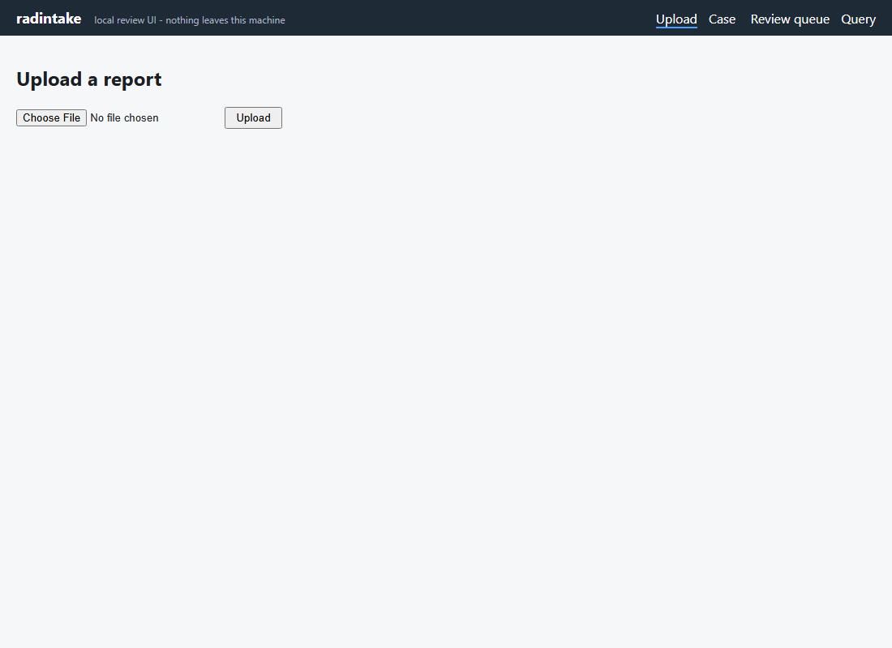
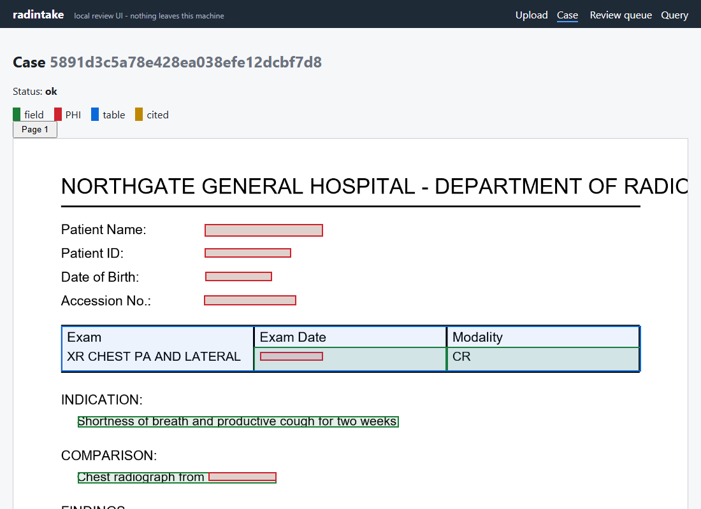
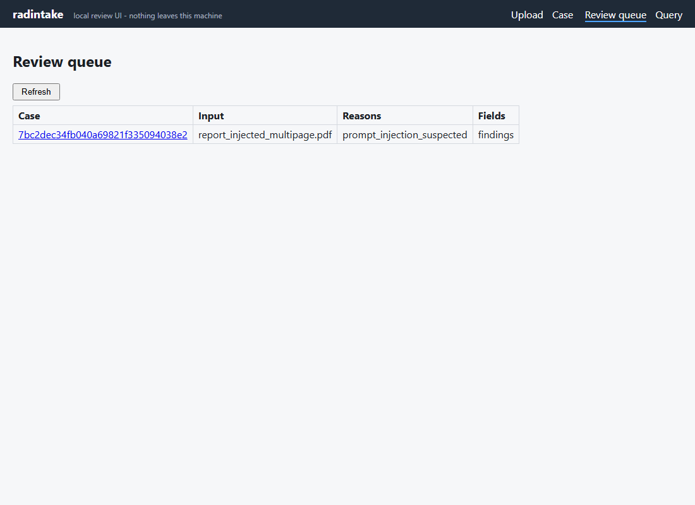
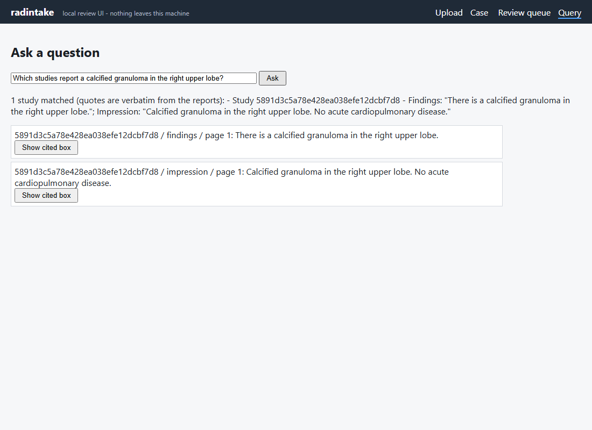

# radintake

PHI-safe, multi-agent intake of scanned radiology reports (clean scans, poor scans, phone photos;
PNG/JPEG/PDF/TIFF) and DICOM images. It produces structured, source-cited extractions, a human-review
queue, cited retrieval / QA with abstention, and an evaluation harness with a CI regression gate.
**Every model is open source and runs locally** (Tesseract 5, Qwen2.5-VL-3B and Qwen2.5-3B via Ollama,
Florence-2, all-MiniLM-L6-v2), so the cost per page is $0 and no page leaves the machine.

- Design and decisions: [`PLAN.md`](PLAN.md), [`docs/agents_vs_fixed.md`](docs/agents_vs_fixed.md),
  [`docs/ocr-engine.md`](docs/ocr-engine.md). The living architecture bundle is [`okf/index.md`](okf/index.md).
- Scope: [`requirements.md`](requirements.md). The end-to-end contract is [`tests/integration/`](tests/integration/).
- Results: [Results](#results) below; the full report is built by `docs/report/build_report.py` (see [Report](#report)).

## Architecture in one paragraph

A fixed pipeline with agentic branches. The **router** types the input; the **planner** runs stages
under step / time / retry budgets and records every decision in a PHI-free trace. Pages are
**preprocessed** (dewarp, illumination flattening, orientation, deskew, denoise/CLAHE) into derived
images while every box stays in original-page pixels. The **PHI agent** (layout anchors + regex +
NER) masks the page **before any model sees it**; `ModelClient` refuses an unmasked page. DICOM goes
through **dicom_deid** (profile-driven header actions, UID remapping, burned-in text redaction).
**Extraction** is OCR-first by default (hybrid and VLM-first are switchable), then **verify** grounds
each value in the OCR text and **injection** checks for instructions hidden in report text. Low
confidence goes to the **review queue**; verified fields go to the **retrieval index** (SQLite FTS5
BM25 + embeddings, RRF) behind a **QA agent** that answers only with verified citations (document,
page, bbox) and abstains otherwise. Storage is one SQLite file holding JSON documents keyed by a
pseudonymous `subject_key`; there is no vector database (the corpus is small and FTS5 + in-row
embeddings are enough).

## Data licensing

The IU Chest X-ray collection (Open-i) is **CC BY-NC-ND 4.0**. No rendered pages or raw data are
committed: only scripts, seeds, ids and split files needed to regenerate them. Score records and
committed traces hold ids, numbers and sha256 hashes, never values. Test fixtures are synthetic and
generated at test time. TCIA Pseudo-PHI-DICOM-Data is used locally and never committed.

## Setup

Python 3.11, Tesseract 5 on `PATH`, and [Ollama](https://ollama.com) for the VLM / answer model.

```bash
python -m venv .venv
.venv/Scripts/python -m pip install -r requirements.lock          # Linux/macOS: .venv/bin/python
.venv/Scripts/python -m pip install -e ".[dev]" --no-deps
ollama pull qwen2.5vl:3b && ollama pull qwen2.5:3b                # only for hybrid / VLM-first / LLM answers
```

`RADINTAKE_OFFLINE=1` uses local models only (the default in Docker and CI). Hardware used for every
number below: RTX 3050 Laptop 4 GB, Windows 11; the default OCR-first pipeline needs no GPU.

## Data download and generation

```bash
pip install -e ".[data]" && playwright install chromium
python -m data_prep.download iu --no-images   # 3,955 IU XML reports -> data/iu (sha256 manifest)
python -m data_prep.iu_parse                  # -> data/iu/reports.jsonl
python -m data_prep.audit                     # -> data_prep/audit.md (aggregates only)
python -m data_prep.fonts                     # handwriting fonts (OFL/Apache, sha256-pinned)
python -m data_prep.render                    # 330 docs, synthetic identities (Faker seed 140)
python -m data_prep.generate                  # 3 degradation tiers, PNG/JPEG/PDF/TIFF + box-exact GT
python -m data_prep.split                     # near-dup groups + dev/golden split -> splits/ (committed)
python -m data_prep.dicom_gt                  # TCIA evaluation/curated pairs -> DICOM ground truth
```

TCIA Pseudo-PHI-DICOM-Data is downloaded by hand with the NBIA Data Retriever into `data/tcia/`
(both the evaluation and the curated halves). `splits/golden.lock` pins the golden list by hash.

## Service (Docker Compose)

```bash
docker compose up -d --build --wait      # API on http://localhost:8000 (CPU)
curl -fsS http://localhost:8000/health
docker compose --profile ocr-gpu up -d --build --wait   # optional NVIDIA variant on :8001
docker compose down
```

| Endpoint | Purpose |
|---|---|
| `POST /cases` | upload a file (multipart); returns the case id |
| `GET /cases/{id}` | status, extraction with confidence and provenance, review flags |
| `GET /review-queue` | cases and fields waiting for a human |
| `POST /query` | `{"question": ...}` → cited answer or abstention |
| `GET /health` | liveness, model availability |

The VLM runs in Ollama on the host (`OLLAMA_HOST`, default `http://host.docker.internal:11434`).
Data and traces live in the `radintake-data` volume. Logs are structured JSON with no PHI.

### Review UI

With the service running, open **http://localhost:8000/ui** (a plain HTML/JS page served by the API itself;
no build step, no CDN, no external requests - a strict Content-Security-Policy enforces it).

- **Upload**: send a report (PNG/JPG/PDF/DICOM/zip) to `POST /cases`; the page polls the case until it finishes.
- **Case**: the PHI-masked page image (`GET /cases/{id}/pages/{n}.png`) with boxes drawn in original page
  pixels: green = extracted fields, red = PHI detections, blue = tables, amber = a cited box.
- **Review queue**: cases waiting for a human, with flags and fields; click one to open it.
- **Query**: ask a question; the answer lists its citations (open one to see the cited box) or the abstention.

Screenshots use synthetic fixtures only.






## Batch CLI

```bash
radintake batch --in <folder> --out <folder> [--config my.yaml]
```

Writes one `<input-name>.json` per input following [`schemas/cli_output.v1.json`](schemas/cli_output.v1.json):
`status`, `input_type`, `report` fields (value, confidence, provenance `{page, bbox, source}`,
`needs_review`), PHI detections (types and boxes, never values), `injection` flags and `trace_id`.
Documents with tables also get an optional `tables` array (cells with text, box and confidence;
[`schemas/tables.v1.json`](schemas/tables.v1.json)). Digital PDFs are read from their text layer.
Unsupported or corrupt files get `status: "error"` and never stop the batch.

## Seeing what each step does

```bash
python -m radintake.inspect <file-or-folder> --out runs/inspect [--pipeline hybrid]
```

Writes `runs/inspect/index.html`: per input, the original, preprocessed and PHI-masked page, the OCR
words, the VLM input and reply (if any), the extraction with provenance boxes and the trace.
DICOM inputs show the pixel data before and after redaction. Output is local only (it shows PHI).

## Evaluation and the CI gate

```bash
python -m radintake.eval.run --split dev [--pipeline ocr_first|vlm_first|hybrid] [--sample-per-tier K] [--dicom]   # QA set scored by default
python -m radintake.eval.run --split golden --final --dicom        # once only; writes eval/GOLDEN_USED.json
python -m radintake.eval.error_analysis --run runs/<run>            # 10 worst pages, categories, overlays
python -m radintake.eval.rescore --traces traces/final --check      # re-score with every model call forbidden
python -m radintake.eval.gate --subset ci                           # the CI regression gate, locally
python -m radintake.eval.versions                                   # check the prompt/schema/config lock
```

CI ([`.github/workflows/ci.yml`](.github/workflows/ci.yml)) runs lint, unit tests, the offline
integration suite and the gate against [`eval/baseline.json`](eval/baseline.json) on a licence-free
synthetic subset. Commit `f5d4033` breaks the patient-name PHI anchor on purpose (CI red) and
`19c9d6e` reverts it (CI green).

## Results

<!-- RESULTS:START -->
Single golden run `20261124T170304Z-a5a6c448` (OCR-first, 112 documents / 145 pages,
scored once; record in [`traces/final/`](traces/final/), re-scorable offline).

| Tier | Field EM | CER | Hallucination | Omission | PHI recall |
|---|---|---|---|---|---|
| **Overall** | 0.672 | 0.169 | 8.8% | 7.6% | 83.1% |
| Clean scan | 0.884 | 0.016 | 0.9% | 0.0% | 91.0% |
| Poor scan | 0.579 | 0.218 | 8.7% | 9.7% | 80.8% |
| Phone photo | 0.549 | 0.279 | 18.4% | 13.3% | 77.7% |

- **PHI (documents):** recall 83.1%, precision 80.7%; 149 of 883 instances missed,
  mostly technologist / radiologist names and patient names on photos (all listed by id in `metrics.json`).
- **DICOM (48 TCIA files):** 100.0% valid after redaction, header PHI recall 100.0%, UIDs remapped
  100.0%, burned-in text-pixel recall 61.5% (precision 54.4%).
- **Retrieval / QA (32 questions):** recall@5 0.549, citation accuracy 100.0%,
  answer correctness 71.9%, correct abstention 96.9%.
- **Injection:** 4 injected documents, 1 flagged, 0 changed behaviour, 0 false flags.
- **Operations:** 59.8% of documents to human review; latency p50 2.3 s / p95 3.5 s
  per page on CPU; GPU peak 0 MiB; cost $0.00 per page.
- **10 worst pages:** [`eval/results/error_analysis_golden.md`](eval/results/error_analysis_golden.md): 6 of 10 are phone photos and
  OCR reads almost nothing on most of them (on dev this was traced to the page-quad detector missing the paper edge).
<!-- RESULTS:END -->

### Pipeline comparison (dev, 18 documents, 6 per tier)

| Pipeline | Exact match | CER | Hallucination | Omission | p50 / p95 per doc | GPU peak |
|---|---|---|---|---|---|---|
| **OCR-first (default)** | 0.642 | 0.146 | 10.5% | 5.4% | 2.3 s / 3.1 s | 0 |
| Hybrid (VLM re-reads low-confidence crops) | 0.651 | 0.147 | 7.7% | 5.4% | 11.9 s / 35.5 s | 2.9 GB |
| VLM-first (Qwen2.5-VL-3B) | 0.421 | 0.485 | 10.6% | 33.9% | 16.8 s / 35.9 s | 2.9 GB |

OCR-first stays the default: hybrid gains 0.9 points of exact match (all on phone photos) for 5× the
latency. Raw numbers: [`eval/results/pipeline_comparison.json`](eval/results/pipeline_comparison.json);
failed attempts: [`eval/results/attempts.md`](eval/results/attempts.md).

### Phone photos: page detection (added after the golden run; dev evidence)

On a lit phone photo the old page detector (one global threshold) often missed the paper edge or
merged a bright desk corner into the page. A contour quad is now kept only if every side lies on a
paper edge; otherwise a line-based detector (text closed away, Canny + Hough lines, each side checked
for a local paper/desk step) supplies the quad. Scans without a paper edge are never dewarped.
Full dev set, same 218 documents, OCR-first, offline
([`eval/results/phone_photo_v2.json`](eval/results/phone_photo_v2.json)):

| Dev tier | Exact match before → after | CER | Omission | PHI recall |
|---|---|---|---|---|
| Phone photo (dev) | 0.500 → **0.614** | 0.298 → 0.195 | 16.0% → 6.6% | 76.3% → 88.1% |
| Clean scan (dev) | 0.903 → 0.903 | 0.013 → 0.013 | 0.0% → 0.0% | 93.8% → 93.8% |
| Poor scan (dev) | 0.571 → 0.571 | 0.213 → 0.213 | 8.9% → 8.9% | 84.2% → 84.2% |

The line detector supplies the quad on 70 of 87 dev photo pages; the 10 worst baseline pages go
from 75% to 25% of fields omitted. Golden set not re-run (single-use).

### OCR engine trial: Tesseract vs PaddleOCR (dev evidence)

`ocr.engine` (or `RADINTAKE_OCR_ENGINE`) switches the OCR backend between Tesseract 5 (default) and
PaddleOCR PP-OCRv4 (optional `[paddle]` extra, pinned in `requirements-paddle.lock`; CI and the Docker
image stay Tesseract-only). Same 60 dev documents (20 per tier), OCR-first, offline, CPU for both
([`eval/results/ocr_engine_comparison.json`](eval/results/ocr_engine_comparison.json)):

| Dev tier | Exact match Tesseract / PaddleOCR | CER | PHI recall | PHI precision | p50 / p95 per page |
|---|---|---|---|---|---|
| Clean scan | **0.861** / 0.792 | 0.024 / 0.025 | 96.1% / 98.0% | 78.8% / 75.7% | 3.8 s / 4.3 s vs 6.3 s / 10.2 s |
| Poor scan | **0.511** / 0.402 | 0.251 / 0.204 | 83.2% / 92.9% | 74.2% / 67.4% | 3.0 s / 4.1 s vs 6.4 s / 10.7 s |
| Phone photo | **0.547** / 0.413 | 0.199 / 0.096 | 87.5% / 90.1% | 79.2% / 70.7% | 3.9 s / 5.1 s vs 6.8 s / 9.8 s |

Tesseract stays the default for every input class: PaddleOCR reads characters better on photos and
finds more PHI, but loses exact match everywhere (it drops the space after label punctuation, e.g.
`No.ACC-…`, which the OCR-first label parser keeps in the value) and is about 1.8× slower. Details:
[`docs/ocr-engine.md`](docs/ocr-engine.md).

### PDF text layer and tables (added after the golden run; dev and synthetic evidence)

Digital PDFs are now read from their own text layer instead of OCR on a raster. Invisible text
(white, smaller than 4 pt, or off the page) is dropped and sends the case to review. A `tables` stage
detects ruled, rules-only and borderless tables, and on scans it re-reads each ruled cell on its own.
Tables are emitted as an optional `tables` array ([`schemas/tables.v1.json`](schemas/tables.v1.json));
`cli_output.v1` is unchanged. Design notes: [`okf/subsystems/tables-and-text-layer.md`](okf/subsystems/tables-and-text-layer.md).

Synthetic table set: 40 reports × 3 variants, 88 tables, no IU text
(`python -m data_prep.tables_set`, then `python -m radintake.eval.tables_eval`;
[`eval/results/tables_eval.json`](eval/results/tables_eval.json)):

| Input | Tables found | Cell exact match | Field exact match | Findings exact match | Hidden text flagged | p50 per doc |
|---|---|---|---|---|---|---|
| Digital PDF, `main` (before) | 0% | 0.000 | 0.658 | 0.225 | 0 of 5 | – |
| **Digital PDF, text layer** | 100% | **1.000** | **1.000** | **1.000** | **5 of 5** | 0.6 s |
| Digital PDF, OCR only (text layer off) | 99% | 0.890 | 0.997 | 1.000 | 0 of 5 | 4.9 s |
| Clean scan PDF | 100% | 0.917 | 0.992 | 1.000 | – | 5.8 s |
| Poor scan PDF | 81% | 0.506 | 0.703 | 0.575 | – | 5.0 s |

Dev set (218 image-only documents, so the text layer never applies; the gains come from table
cells read one at a time; [`eval/results/dev_tables_comparison.json`](eval/results/dev_tables_comparison.json)):
- **Exam date:** exact match 0.50 → 0.60 overall, and 0.16 → 0.32 on phone photos.
- **Patient name:** exact match 0.69 → 0.71.
- **Document PHI recall:** 82.7% → 84.8%.
- **Latency:** p95 per page 14.2 s → 5.0 s.
- **PHI precision:** measured on boxes, it fell from 80.7% to 78.7%. That is because 28 exam dates are now read correctly and masked; the dev ground truth doesn't count exam dates as PHI, although HIPAA does.
- **Golden set:** not re-run, because it is single-use.

## Reproducing every number

1. Generate the data (above), then `python -m radintake.eval.versions` must pass.
2. Dev: `python -m radintake.eval.run --split dev --dicom` and, for the comparison,
   `--sample-per-tier 6 --pipeline {ocr_first,hybrid,vlm_first}`.
3. Golden (already used once; `eval/GOLDEN_USED.json` records it): re-score the committed traces with
   `python -m radintake.eval.rescore --traces traces/final --check --verify-gt`.

Seeds: data 140 (numpy + Faker), split 140. Model ids, prompt hashes and library versions are written
into every `run.json` and pinned in `eval/VERSIONS.lock` and `requirements.lock`.

## Report

`python docs/report/build_report.py --run runs/golden_final` builds `docs/report/out/report.{html,pdf}` (9 pages:
architecture, data, golden tables per field and tier, pipeline comparison, PHI and residual cases, DICOM before/after,
injection, error analysis with best/median/worst overlays, chronology with failed attempts, technical details, traces).
The output is not committed because it shows rendered IU pages (CC BY-NC-ND); it is shared with the assessor directly.

## Repository layout

```
src/radintake/      agents/ (preprocess, phi, dicom_deid, extract_*, verify, injection, qa),
                    orchestrator/ (router, planner), tools/ (OCR, VLM client, image ops, loader),
                    api/, store/, tracing/, eval/, retrieval.py, inspect.py, cli.py
data_prep/          download, parse, audit, render, degrade, generate, split, DICOM ground truth
configs/            default, models, PHI, DICOM profile, degradation tiers
prompts/, schemas/  versioned and immutable (a change is a new _vN file)
eval/               baseline, version lock, golden and dev QA sets, committed results
splits/             dev / golden ids, golden lock, near-duplicate groups
tests/              unit/ and integration/ (synthetic fixtures only)
okf/                architecture knowledge bundle
```
